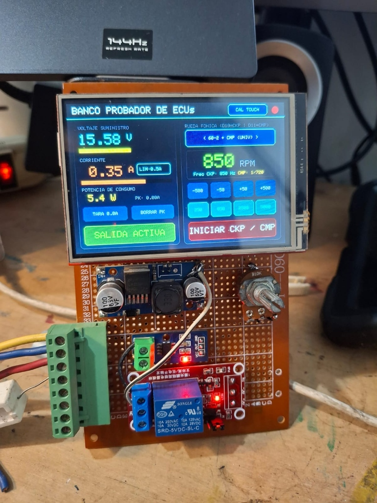

# Banco Probador de ECUs Automotrices: Fuente de Poder Protegida + Simulador CKP y CMP



Sistema embebido basado en **Arduino UNO / MEGA** con pantalla táctil **TFT 3.5" (`MCUFRIEND_kbv`)**, diseñado para alimentar y probar Unidades de Control Electrónico (ECUs) automotrices en banco. Integra una fuente de laboratorio regulable con **protección electrónica por sobrecorriente (fusible digital programable)** y un **generador sincronizado de señales de Cigüeñal (CKP) y Árbol de Levas (CMP)** por interrupción de hardware (`Timer1`), además de telemetría bidireccional por Puerto Serial para software de escritorio.

---

## Características Principales

### 1. Fuente de Alimentación Instrumentada y Protegida
* **Voltímetro Digital (`0V – 30V DC`):** Medición en tiempo real mediante divisor resistivo con sobremuestreo de 16 lecturas y filtro exponencial suave.
* **Amperímetro de Precisión con `ACS712 (30A)`:** Sobremuestreo de 128 muestras con calibración de 2 puntos (Cero y Span) para medir desde consumos bajos de lógica de ECU (`0.10 A – 0.50 A`) hasta cargas con actuadores.
* **Vatímetro (`W`) y Registro de Pico (`PK`):** Cálculo instantáneo de potencia consumida y retención del pico máximo de corriente.
* **Fusible Electrónico Programable (`LIM`):** Corte automático por relé/MOSFET en caso de cortocircuito o sobreconsumo en la ECU, seleccionable desde la pantalla táctil en escalones de:
  * **`0.5 A` (`500 mA`) → `1.0 A` → `2.0 A` → `3.0 A` → `3.5 A` → `5.0 A`**
* **Retención de Corriente de Disparo en Rojo:** Cuando la protección se dispara, congela en color **ROJO** el valor exacto de corriente que ocasionó el corte y muestra el botón **`RESET SALIDA`**.
* **Botón `TARA 0.0A` con Memoria `EEPROM`:** Permite calibrar el punto cero exacto del sensor Hall ACS712 y conservarlo al apagar el equipo.

### 2. Generador Sincronizado de Rueda Fónica (`CKP` + `CMP`)
* **Motor por Hardware (`ISR(TIMER1_COMPA_vect)`):** Generación de pulsos en tiempo real mediante registros directos (`PORTB`), 100% libre de *jitter* o pausas mientras se refresca la pantalla TFT o se lee el panel táctil.
* **Patrones Incluidos:**
  1. **`60-2 + CMP`** *(Universal: Bosch, VW, Renault, Chevrolet, Peugeot, Fiat)*
  2. **`36-1 + CMP`** *(Ford, Mazda)*
  3. **`36-2 + CMP`** *(Toyota, Subaru, Denso)*
  4. **`4 Pulsos por vuelta + CMP`** *(Distribuidor / Hall continuo)*
* **Rango de `150` a `8000 RPM`:**
  * Botones de paso fino (`-50`, `+50`) y rápido (`-500`, `+500`).
  * 4 memorias rápidas de prueba: **`250 RPM`** *(Arranque / Cranking)*, **`850 RPM`** *(Ralentí / Idle)*, **`2500 RPM`** *(Media carga)* y **`5000 RPM`** *(Alta revolución)*.

### 3. Calibración Táctil en Vivo y Telemetría Serial (`115200 bps`)
* **Asistente de Calibración Táctil de 3 Puntos (`CAL TOUCH`):** Corrige automáticamente ejes cruzados o invertidos de cualquier variante de shield 3.5" y almacena los parámetros en `EEPROM`.
* **Protocolo Serial para Software de Escritorio:** Emite tramas de telemetría cada `200 ms` (`5 Hz`) y acepta comandos remotos.

---

## Pinout y Conexiones de Hardware

| Función del Probador | Pin Arduino UNO | Pin Arduino MEGA | Detalles de Conexión |
| :--- | :---: | :---: | :--- |
| **Pantalla TFT 3.5" + Touch** | `A0–A3`, `D2–D9` | `A0–A3`, `D2–D9` | Conectada como Shield. En Arduino UNO doblar los pines `LCD_RST` (`A4`) y `F_CS` (`A5`) del shield, uniendo `LCD_RST` al pin `RESET` del Arduino. |
| **Voltímetro Fuente (`0–30V`)** | **`A4`** | **`A8`** | Divisor resistivo: $R_1 = 52.6\text{ k}\Omega$ ($47\text{ k}\Omega + 5.6\text{ k}\Omega$) al positivo de salida y $R_2 = 9.77\text{ k}\Omega$ (nominal $10\text{ k}\Omega$) a `GND`. |
| **Amperímetro `ACS712 (30A)`** | **`A5`** | **`A5`** | `VCC` → `5V`, `GND` → `GND`, `OUT` → **`A5`**. Bornera `IP+` (pines 1–2) a la salida `NO` del relé; bornera `IP-` (pines 3–4) hacia la ECU. |
| **Señal `CKP` (Cigüeñal)** | **`D10`** | **`D10`** | Salida digital `0–5V` (`Timer1`). Usar resistencia de `330 Ω – 1 kΩ` en serie. |
| **Señal `CMP` (Árbol de Levas)** | **`D11`** | **`D11`** | Salida sincronizada `0–5V` (`1 pulso` cada $720^\circ$ de giro CKP). |
| **Relé de Protección Salida** | **`D12`** | **`D12`** | Controla el módulo Relé (contacto `COM` a la salida del regulador `LM2596` y contacto `NO` hacia el `ACS712`). |

---

## Protocolo de Comunicación Serial (`115200 baudios`)

### Trama de salida (cada `200 ms`):
```text
DATA,V=15.58,I=0.35,P=5.4,PK=0.35,IMX=0.50,RPM=850,FREQ=850,PAT=60-2,GEN=0,PWR=1,TRIP=0
```

### Comandos entrantes soportados (terminados en `\n`):
* `RPM=1500` → Ajusta las RPM (`150` a `8000`).
* `PAT=0` → Selecciona patrón (`0`: 60-2, `1`: 36-1, `2`: 36-2, `3`: Hall 4 pulsos).
* `GEN=1` / `GEN=0` → Inicia (`1`) o detiene (`0`) la generación CKP/CMP.
* `PWR=1` / `PWR=0` → Activa (`1`) o corta (`0`) la salida de alimentación (y resetea disparo por corto).
* `ILIM=300` → Ajusta el límite de corriente en centiamperios (`50` a `500`, ej. `300` = `3.00 A`).
* `TARE` → Ejecuta la tara `0.00 A` del sensor ACS712 y la guarda en `EEPROM`.
* `PEAKRST` → Reinicia el pico máximo de corriente (`PK`).
* `CAL` → Lanza el asistente de calibración táctil en pantalla.

---

## Estructura del Repositorio

* [`Probador_ECUs/Probador_ECUs.ino`](./Probador_ECUs/Probador_ECUs.ino): Firmware principal optimizado en punto fijo para Arduino UNO y Arduino MEGA.
* [`MCUFRIEND_kbv/`](./MCUFRIEND_kbv/): Librería gráfica para el display TFT paralelo de 3.5".
* [`hardware_probador_ecus.jpg`](./hardware_probador_ecus.jpg): Fotografía del prototipo físico en operación.
